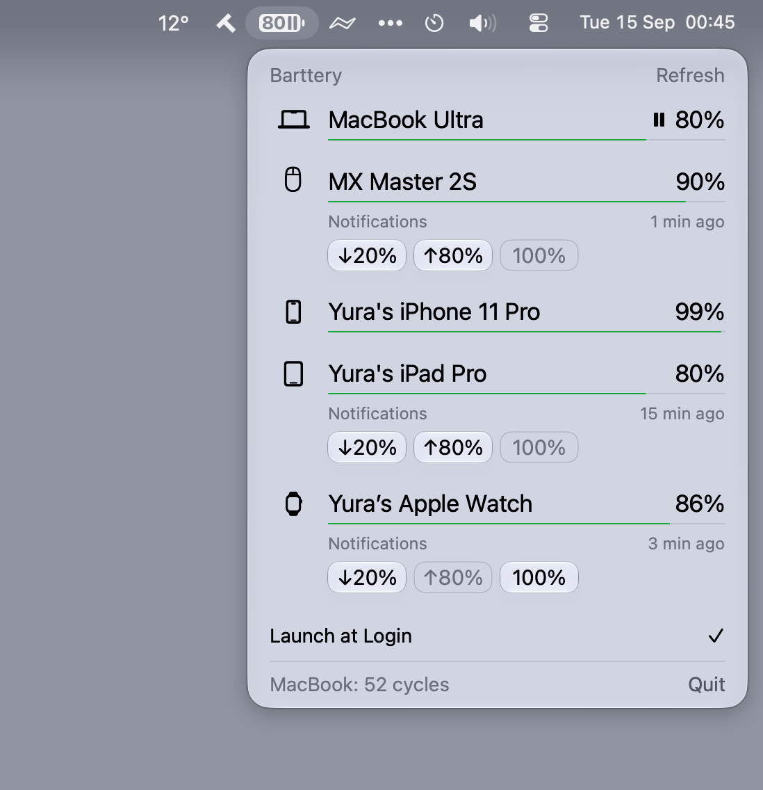

<p align="center">
  
</p>

# Barttery

A macOS menu bar app that shows battery levels for all your devices in one place.

Starting with version 1.2.0, Barttery is signed with Developer ID and notarized by Apple.

## Features

- MacBook — battery percentage with charging state icon, time to full / time remaining, cycle count
- iPhone & iPad — battery level via USB or Wi-Fi
- Apple Watch — battery level via paired iPhone
- AirPods — headphones and case battery levels with charging indicators
- Magic Keyboard, Mouse & Trackpad — battery levels via Bluetooth
- Logitech mice — MX Master 2S/3/3S/4, MX Anywhere 2S/3/3S, MX Ergo, M720 Triathlon, MX Vertical — battery level and charging indicator via HID++ 2.0
- Logitech keyboards — MX Keys, MX Keys Mini, MX Keys S, K380, K780, K850 — battery level via HID++ 2.0
- Bluetooth headphones — battery level via Bluetooth
- BLE devices — any Bluetooth LE peripheral with a standard Battery Service
- Desktop widgets — battery rings and tables for macOS 14 and later

Notifications — get alerted when any device drops to 20%, or reaches 80% / 100% while charging. Configure per device.

> **Logitech devices** require Input Monitoring permission (System Settings → Privacy & Security → Input Monitoring). Without it, Logitech devices still appear via Bluetooth with approximate battery level.

Logitech HID++ battery and charging status are polled every 15 seconds, as well as
when opening the popup and after wake. A Developer ID signature does not bypass
Input Monitoring: grant access to the installed Barttery app, then quit and reopen
it if macOS requests a restart. If access stops working after switching from an
ad-hoc build to Developer ID signing (or changing the bundle identifier), remove
the old Barttery entry in Input Monitoring and add the new app from Applications.
Keep the same bundle identifier and signing team for subsequent releases.

If a HID++ query fails, recent readings are retained for up to two minutes, then
available BLE readings are used instead. BLE battery percentages alone cannot
reliably detect a charging cable being plugged in or removed, so an unconfirmed
charging state is shown without a charging icon, not inferred from a rising percentage.
A HID++ charging-only response can supply the charging state while Bluetooth
supplies the percentage. The HID++ charging indicator represents active charging, not simply an
attached cable alone; the device's explicit full-on-charger status also keeps
the lightning indicator visible, including at 100%.

Last-update times belong to individual accessories, including after Bluetooth
renaming, rather than to a shared mouse/keyboard category. A successful read of
an unchanged percentage still counts as a new read; displaying cached values or
receiving an update from another device does not. Unknown dates are shown as
unknown instead of enormous elapsed-time counters. Widgets use the same per-device
measurement timestamps.

Apple Watch charging uses live power-source observations, not an indefinitely
cached companion-registry charging flag. An explicit unplug observation clears
the charging indicator immediately. A charging observation without confirmation
for three minutes loses its charging icon if the live event stream is unavailable.
An uninterrupted live subscription retains the last observed state until the next
transition; helper heartbeats track subscription health, not battery freshness.
Internally missing state remains unknown, not confirmed discharging.
Successful registry reads can refresh the percentage
but do not extend the charging observation's lifetime. Background Wi-Fi monitoring
listens for power events even when registry queries succeed.

## Screenshot



## Requirements

- Apple Silicon Mac (arm64) running macOS 13 Ventura or later (including macOS 27)
- Desktop widgets require macOS 14 Sonoma or later
- For iPhone / iPad / Apple Watch: connect via USB cable to Mac and enable Wi-Fi sync in Finder. On the first USB connection, you'll need to **Trust** the computer.

## Installation

Version **1.2.2** fixes iPhone/Apple Watch device helper loading and accessory
last-update timestamps. It includes Sparkle in-app updates, the desktop widget, and a Liquid
Glass icon on macOS 26 and later. Both the app and DMG are signed with
Developer ID and notarized by Apple; no Gatekeeper exception is normally needed.

### Homebrew

```sh
brew install --cask yurastegny/tap/barttery
```

If Homebrew reports that the cask is from an untrusted tap (Homebrew 7 and later),
trust this specific cask, then repeat the install command:

```sh
brew trust --cask yurastegny/tap/barttery
```

To update a Homebrew-installed copy when a newer version is available:

```sh
brew update
brew upgrade --cask yurastegny/tap/barttery
```

Homebrew automatically adds the tap on first installation; no separate `brew tap`
command is needed. The installation cask is maintained in
[yurastegny/homebrew-tap](https://github.com/yurastegny/homebrew-tap).
If you already installed Barttery through Homebrew, do not install a second copy
from another tap.
If Barttery is already installed manually, quit it and move the existing app out
of Applications before installing through Homebrew. Do not delete your settings.

### Download the DMG

- Download `Barttery-1.2.2.dmg` or a newer release from the [releases page](https://github.com/yurastegny/barttery/releases/latest)
- Open the DMG file
- Drag the Barttery app to your Applications folder
- Launch Barttery — it appears in the menu bar
- On first launch, macOS may ask for Bluetooth and notification permissions — allow both

For manual updates, quit Barttery and replace the app in Applications with the new
version. Version 1.2.1 introduces Sparkle as described below. Users of 1.2.0 and
earlier must update manually or through Homebrew once to enable future in-app
updates. When a newer compatible release is detected, **Update Available…**
appears below **Launch at Login**.

### Older, ad-hoc-signed releases

Older, ad-hoc-signed releases may require the steps below. Developer ID-signed and
notarized releases do not normally require a Gatekeeper exception.

**macOS 13–14:** Control-click **Barttery** → **Open** → **Open**.

**macOS 15 and later:**

1. Double-click **Barttery**. You'll get a warning such as **"Apple could not verify "Barttery" is free of malware"** or **"Barttery" can't be opened because the developer cannot be verified**.
2. Click **Done** — not **Move to Trash**.
3. Open **System Settings → Privacy & Security** and scroll down to **Security**.
4. Click **Open Anyway** next to the message that Barttery was blocked, then enter your password (or use Touch ID) and click **Open**.

After this, macOS remembers the exception and the app launches normally.

## Desktop widget (macOS 14+)

The published DMG and Homebrew cask include the widget; no separate build or
installation is required. Launch Barttery from Applications, then right-click the
desktop → **Edit Widgets** → search for **Barttery** and choose a layout. Keep
Barttery running to provide fresh battery readings.

Barttery includes four WidgetKit variants: a small square with one device, a small
square with four devices (2×2), the original medium rectangle with four devices,
and a table with device icons, names, percentages, and charging/paused status.
The table shows up to four devices in medium size or eight in large size and
replaces the old eight-ring widget. Remove any old eight-ring widget and add
**Batteries · Table** from the gallery. The ring layouts show device names except
for the compact 2×2 layout. They use real readings from the running menu bar app;
the extension does not access Bluetooth or USB itself. After 30 minutes without a
measurement, a device is marked as out of date. WidgetKit controls refresh timing,
so updates are not instantaneous.

The automatic order is Mac, iPhone, iPad, AirPods, AirPods case, Apple Watch, then
accessories. The first one, four, or eight available entries are shown, depending
on the variant. The single-device widget currently uses the first available device.

### Build with the widget

The `make build` / `make dmg` workflow **does not include the widget**. The widget
build uses Xcode and [XcodeGen](https://github.com/yonaskolb/XcodeGen):

1. Install Xcode and XcodeGen (`brew install xcodegen`).
2. Run `xcodegen generate`, then open `Barttery.xcodeproj`.
3. Choose your Apple Developer team for **both** targets in Signing & Capabilities.
   Register/enable `group.me.yura.barttery` for both app identifiers using your
   team's provisioning profiles. If using your own identifiers, update them in
   `project.yml`, both `Widgets/*.entitlements`, and `Sources/WidgetSnapshot.swift`.
4. Build the **Barttery** scheme. The host stays unsandboxed; only the widget
   extension is sandboxed. Signing and App Group access must work for both targets.
5. Quit any older Barttery instance, copy the signed app to Applications, and launch
   it. Right-click the desktop → **Edit Widgets** → search for **Barttery** and add
   **Batteries**. Keep Barttery running for fresh readings.

Command-line signed build: `make widgets TEAM=YOUR_TEAM_ID` (Apple Silicon, matching
the bundled device helpers). Output: `.build/xcode/Build/Products/Release/Barttery.app`.
The `make dmg` recipe builds the non-widget version; it does not package this Xcode
output. For public widget distribution, use appropriate Developer ID signing,
App Group provisioning, and notarization.

Checks without a signing account: `make widgets-check`, `swift test`, and
`make widget-preview` (renders fresh, stale, and empty states into
`.build/widget-preview.png`). An unsigned build only checks compilation; it does
not verify widget registration or cross-process App Group access.

### Device helper packaging

Device helpers and their dylibs are copied into `Contents/Resources`. Before
signing, both build systems run `scripts/prepare-device-helpers.py` to rewrite
all bundled dependencies, including transitive dylib dependencies, to
`@loader_path/<library-name>`. Helpers must not rely on `DYLD_LIBRARY_PATH`,
which Hardened Runtime ignores. The script changes only build-product copies;
the source binaries remain untouched. It also sets executable permissions at
build time, so the running app does not need to modify its own signed resources.

To verify an exported/notarized app without modifying its signature:

```sh
python3 scripts/prepare-device-helpers.py --check /path/to/Barttery.app/Contents/Resources
```

Dependency closure, missing helpers, transitive libraries, build integration,
and idempotency are covered by the Python regression tests:

```sh
python3 -m unittest discover -s Tests -p 'test_*.py'
```

### Application icons

The Xcode build compiles `Icons/AppIcon.icon` for Liquid Glass on macOS 26 and
later. Xcode also generates a static, backwards-compatible icon for macOS 13–15
from the same design, including transparent margins, rounded corners, and a
shadow. The system selects the representation independently of the update
mechanism. Verify the final appearance in Finder on both older and newer macOS
versions before release.

The SwiftPM-only build still uses the existing `AppIcon.icns`; it does not compile
Icon Composer resources. For the new icon and the widget, use the Xcode build.
Icon changes require rebuilding, signing, and notarizing a new release. Never
modify the resources inside an already signed application.

## In-app updates (Sparkle)

The Xcode build embeds Sparkle 2.10.1 in the host app, not the widget. It checks
for signed updates approximately once a day. A deferred update adds **Update
Available…** directly below **Launch at Login**. When no update is available, the
row is absent. Clicking the row opens Sparkle's standard update window; scheduled
checks do not open update windows, send update notifications, or automatically
download and install updates. Once the user gives the update attention, the row
is cleared; Sparkle controls subsequent reminders and skipped versions.

The old GitHub-release notification checker is no longer started. Battery
notifications are unaffected. SwiftPM-only builds intentionally do not embed or
start Sparkle; distribute the Xcode archive to include updates, the widget, and
the new icon.

### Feed and signing key

`project.yml` contains the public Ed25519 key and the permanent HTTPS feed URL:

```text
https://raw.githubusercontent.com/yurastegny/barttery/main/appcast.xml
```

The private key is stored only in the macOS login Keychain under the Sparkle
account **`me.yura.barttery`**. Do not commit or upload it. Preserve it and make a
secure backup before moving to another Mac. To display the existing public key
without creating a replacement, use Sparkle's tool:

```sh
./bin/generate_keys --account me.yura.barttery -p
```

The root `appcast.xml` is the production update feed. Add a release entry only
after its signed, notarized DMG is publicly available. Do not insert placeholder
signatures or links to missing assets. Existing 1.2.0 installations need one
manual or Homebrew update to gain Sparkle support.

### Publishing a Sparkle update

1. Increase `MARKETING_VERSION` and `CURRENT_PROJECT_VERSION` in `project.yml`.
   Sparkle compares **build numbers**, so the latter must increase every time.
   The first Sparkle-enabled build is configured as **1.2.1 (5)**.
2. Regenerate the Xcode project, Archive, and export using Developer ID / Direct
   Distribution. Keep Sparkle's framework and helper signatures intact. Export
   the notarized app with its widget, then package, sign, notarize, and staple the
   final DMG. Do not use the SwiftPM-only `make dmg` for this release.
3. Upload that exact DMG to its GitHub Release. Make sure its public download URL
   works before publishing an appcast entry.
4. Generate the appcast using the tools from the same Sparkle release. For
   example, assuming the tools were unpacked into `.build/sparkle-tools`:

   ```sh
   mkdir -p .build/sparkle-updates/1.2.1
   cp appcast.xml .build/sparkle-updates/1.2.1/
   cp Notarized/1.2.1/Barttery-1.2.1.dmg .build/sparkle-updates/1.2.1/
   .build/sparkle-tools/bin/generate_appcast \
     --account me.yura.barttery \
     --download-url-prefix https://github.com/yurastegny/barttery/releases/download/v1.2.1/ \
     --maximum-deltas 0 \
     .build/sparkle-updates/1.2.1/
   ```

   For subsequent releases, substitute the new version in paths and the URL.
   Seed the staging directory with the current feed so previous entries retain
   their existing download URLs. Put only finalized update archives in it.
5. Review the generated `appcast.xml` for the correct version, build number,
   download URL, size, and EdDSA signature; copy it to the repository root and
   publish it to `main`. Never change the DMG after generating its signature.
6. Test an actual update between two signed, notarized Sparkle-enabled builds,
   using a separate test feed before publishing the production entry. Check the
   reminder, update window, installation, relaunch, widget, and preserved settings.

Apple notarization and Sparkle signatures are separate requirements; one does
not replace the other. Updating through Homebrew remains supported, but do not
run a Homebrew upgrade and a Sparkle installation at the same time.

## Signed releases outside the App Store

`make build` remains a local development build. `make dmg` (also `make release`)
requires a **Developer ID Application** certificate with its private key in your
Keychain, Xcode command-line tools, and an Apple Developer membership.

Find your signing identity:

```sh
security find-identity -v -p codesigning
```

Store notarization credentials once (the command prompts for credentials; use an
app-specific password, not your Apple Account password):

```sh
xcrun notarytool store-credentials Barttery-notary
```

Increase `CFBundleShortVersionString` and `CFBundleVersion` in `Info.plist` for each
SwiftPM release, then run:

```sh
make dmg SIGN="Developer ID Application: Your Name (TEAMID)" NOTARY_PROFILE=Barttery-notary
```

The release signs all bundled helpers/libraries and the app with Hardened Runtime
and a secure timestamp, notarizes and staples the app, then signs, notarizes, and
staples the DMG. Gatekeeper checks must pass before `Barttery-<version>.dmg` is
published in the project directory. An existing DMG is replaced only on success.
Internet access is required. If Apple rejects a submission, retrieve its detailed
log with `xcrun notarytool log <submission-id> --keychain-profile Barttery-notary`.
Never distribute the local Apple Development build as a public release.

This workflow does **not** package the widget; that requires the separate Xcode
build and Developer ID-compatible App Group provisioning for both targets.

## License

Barttery is licensed under the **GPL-2.0-or-later** license. The following third-party components are bundled:

| Component | License |
|---|---|
| [libimobiledevice](https://github.com/libimobiledevice/libimobiledevice) (`ideviceinfo`, `idevice_id`, `comptest`, `bartbeat`) | GPL-2.0+ |
| [libimobiledevice-glue](https://github.com/libimobiledevice/libimobiledevice-glue) | LGPL-2.1+ |
| [libplist](https://github.com/libimobiledevice/libplist) | LGPL-2.1+ |
| [libusbmuxd](https://github.com/libimobiledevice/libusbmuxd) | LGPL-2.1+ |
| [OpenSSL 3](https://github.com/openssl/openssl) (`libssl`, `libcrypto`) | Apache-2.0 |

The Xcode build also embeds [Sparkle](https://github.com/sparkle-project/Sparkle),
distributed under its [MIT license and third-party notices](https://github.com/sparkle-project/Sparkle/blob/2.10.1/LICENSE).
